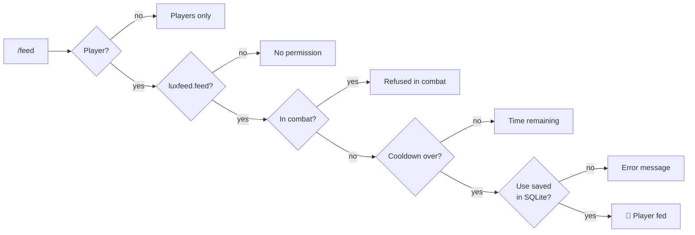
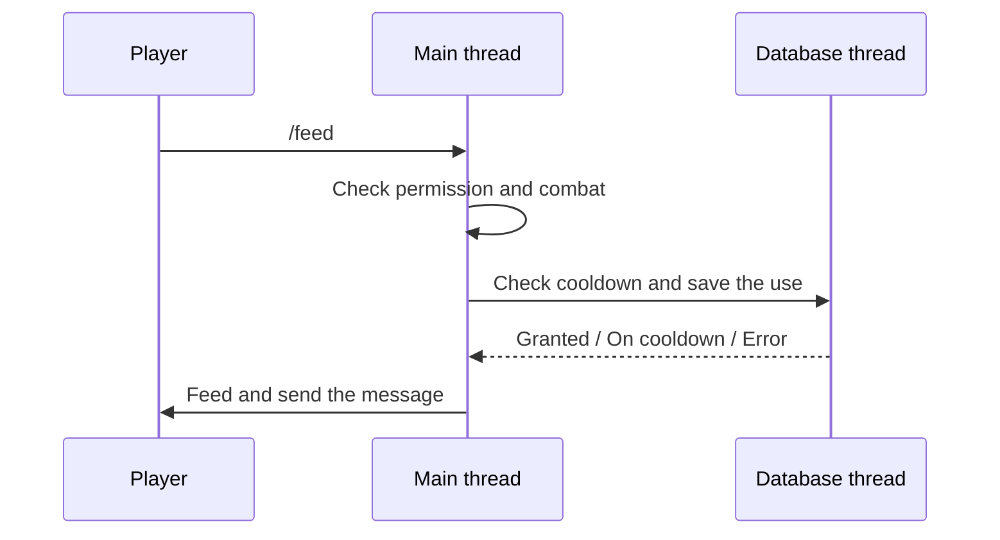

<div align="center">

# 🍖 LuxFeed

**A lightweight Paper plugin that restores hunger and saturation with `/feed`,
limited by a permission-based cooldown that survives restarts.**


[Features](#-features) •
[Installation](#-installation) •
[Configuration](#%EF%B8%8F-configuration) •
[How it works](#-how-it-works) •
[Combat integration](#%EF%B8%8F-combat-integration) •
[Development](#%EF%B8%8F-development)

</div>

---

## ✨ Features

- 🍗 **`/feed`** fully restores hunger and saturation.
- ⏱️ **Permission-based cooldowns**: VIP, premium, staff… the shortest matching cooldown wins.
- 💾 **SQLite persistence**: cooldowns survive disconnections, restarts and reloads.
- 🌍 **English and French** messages, fully editable with [MiniMessage](https://docs.papermc.io/adventure/minimessage/) colors.
- ⚔️ **Combat-ready**: a `CombatCheck` interface to plug in any combat system.
- 🧵 **Main-thread friendly**: every database call runs on a dedicated thread.
- 🛡️ **Safe by default**: invalid configuration never crashes the plugin, it falls back and warns.

## 📦 Installation

> **Requirements:** a Paper **26.2** server running on **Java 25**.

1. Download or [build](#%EF%B8%8F-development) `LuxFeed-<version>.jar`.
2. Drop it into your server's `plugins/` folder.
3. Start the server. LuxFeed creates its files:

```text
plugins/LuxFeed/
├── config.yml      ← language and cooldowns
├── luxfeed.db      ← SQLite database
└── lang/
    ├── en.yml      ← English messages
    └── fr.yml      ← French messages
```

Existing files are never overwritten, so your changes are kept across updates.

## 🎮 Command and permissions

| Command | Description |
|:--------|:------------|
| `/feed` | Fully restores your hunger and saturation. Players only. |

| Permission | Default | Effect |
|:-----------|:-------:|:-------|
| `luxfeed.feed` | ✅ everyone | Allows using `/feed`. |
| `luxfeed.cooldown.default` | ✅ everyone | 60-minute cooldown. |
| `luxfeed.cooldown.vip` | ❌ nobody | 30-minute cooldown. |
| `luxfeed.cooldown.premium` | ❌ nobody | 15-minute cooldown. |
| `luxfeed.cooldown.staff` | ❌ nobody | 5-minute cooldown. |
| `luxfeed.cooldown.bypass` | 👑 operators | No cooldown. |

> 💡 The cooldown tiers are examples from the default `config.yml`. Rename, add or remove them freely.

## ⚙️ Configuration

### Cooldowns

```yaml
cooldowns:
  default:
    permission: "luxfeed.cooldown.default"
    duration-minutes: 60

  vip:
    permission: "luxfeed.cooldown.vip"
    duration-minutes: 30

  premium:
    permission: "luxfeed.cooldown.premium"
    duration-minutes: 15

  staff:
    permission: "luxfeed.cooldown.staff"
    duration-minutes: 5

  bypass:                       # granted to operators by default
    permission: "luxfeed.cooldown.bypass"
    duration-minutes: 0
```

- A player holding **several** tier permissions gets the **shortest** cooldown.
- A player holding **none** of them gets the `default` cooldown.
- `duration-minutes` is a whole number, `0` or more. `0` means no cooldown.

<details>
<summary><b>What happens with an invalid configuration?</b></summary>

<br>

LuxFeed never crashes on a bad value. It logs a clear warning at startup and falls back safely:

| Problem | Result |
|:--------|:-------|
| Negative, decimal or text duration | The tier is ignored. |
| Missing `permission` | The tier is ignored. |
| Missing or invalid `default` tier | 60 minutes is used. |
| Missing `cooldowns` section | 60 minutes is used. |

</details>

### Language

```yaml
language: "en"   # "en" or "fr"
```

Messages live in `lang/en.yml` and `lang/fr.yml` and support MiniMessage colors:

```yaml
feed:
  success: "<green>Your hunger and saturation have been fully restored."
  cooldown: "<red>You must wait <remaining> before using /feed again."
```

An unknown language falls back to English, and any missing message falls back to the default text
bundled in the plugin.

## 🔍 How it works

When a player runs `/feed`, the checks run in this order. The player is fed **only** once all of
them pass:



The database is never touched from the server's main thread:



### 💾 SQLite storage

`luxfeed.db` holds one row per player:

| Column | Type | Content |
|:-------|:-----|:--------|
| `player_uuid` | `TEXT` (primary key) | Player UUID |
| `last_used_at` | `INTEGER` | Last successful `/feed`, in epoch milliseconds |

- 🔒 Every query is a **prepared statement**, and every resource is closed properly.
- 🚦 A **single database thread** handles requests one by one, so spamming `/feed` can never
  bypass the cooldown.
- ✅ The cooldown is **saved before** the player is fed, and **only for successful uses**. If the player
  disconnects or enters combat in between, the use is cancelled.
- 🩹 If the database fails, `/feed` is refused with an error message, the error is logged, and the
  connection is retried on the next use.

> The SQLite driver is not bundled: Paper 26.2 already provides `org.xerial:sqlite-jdbc` 3.49.1.0.

## ⚔️ Combat integration

> [!IMPORTANT]
> LuxFeed does **not** detect combat on its own.

The `CombatCheck` interface is the contract a combat system must fulfil:

```java
@FunctionalInterface
public interface CombatCheck {
    boolean isInCombat(Player player);
}
```

The bundled **`StubCombatCheck`** performs no detection and **always reports "not in combat"**. It lets
the plugin run and be tested without any combat plugin.

To connect your combat system, implement the interface and replace the stub in `LuxFeedPlugin`:

```java
// Example with a hypothetical combat plugin API
CombatCheck combatCheck = player -> MyCombatPlugin.getApi().isTagged(player.getUniqueId());
```

## 🛠️ Development

```bash
./gradlew build    # compile, run the tests and build the jar
./gradlew test     # run the tests only
```

The jar is written to `build/libs/`. Building needs **JDK 25**; the Gradle wrapper is included.

### 🧪 Tests

JUnit tests that run without a Minecraft server:

| Test class | What it checks |
|:-----------|:---------------|
| `CooldownServiceTest` | Default cooldown, shortest matching tier, invalid config, refusal before expiry, use after expiry, simultaneous attempts, database error |
| `SQLiteDatabaseTest` | Timestamp persistence after reopening, error on an unusable file |
| `FeedCommandTest` | Console refusal, combat refusal, feeding then cooldown refusal |
| `StubCombatCheckTest` | The stub never reports combat |
| `MessageServiceTest` | English and French messages, unknown language fallback, duration formatting |

### 📁 Project structure

```text
src/main/java/io/github/isynn/luxfeed/
├── LuxFeedPlugin.java              plugin startup and shutdown
├── command/FeedCommand.java        /feed and its checks
├── cooldown/CooldownService.java   cooldown tiers and cooldown checks
├── database/SQLiteDatabase.java    SQLite access
├── combat/
│   ├── CombatCheck.java            combat system contract
│   └── StubCombatCheck.java        stub, never in combat
└── messages/MessageService.java    language files
```

---

<div align="center">

Made by **[ISynn](https://github.com/ISynn)**

</div>
